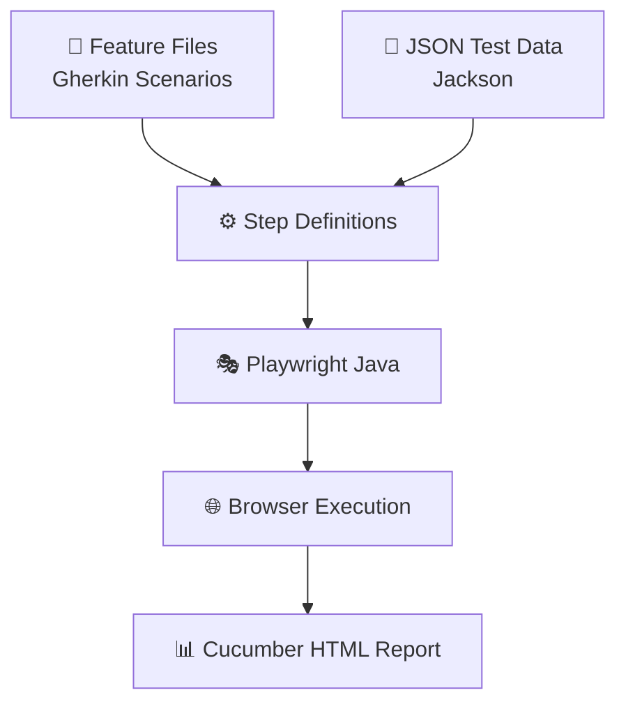
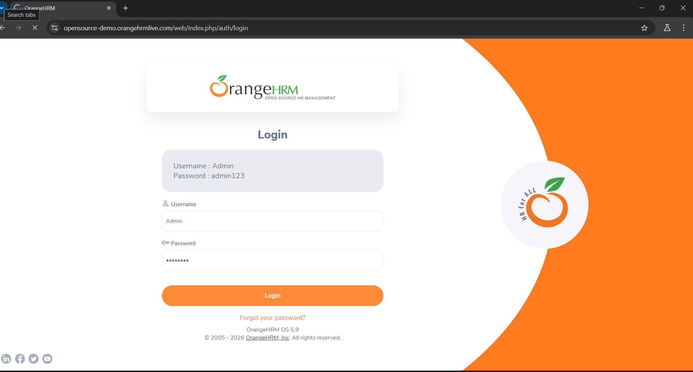
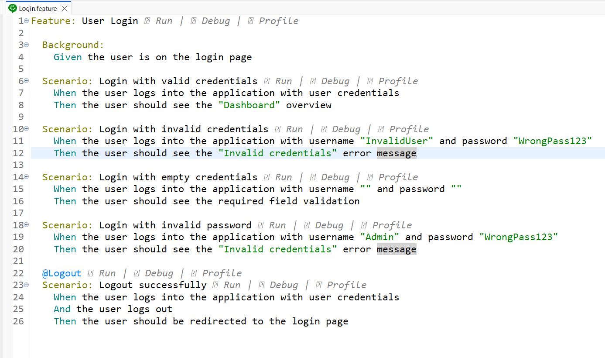
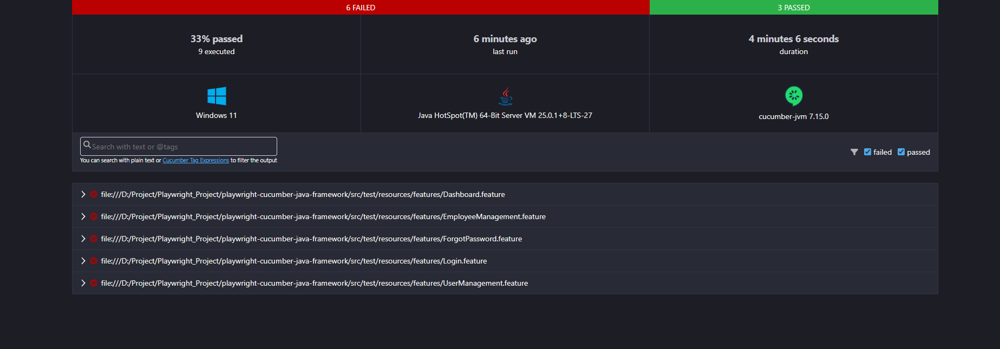

# 🎭 Playwright Java Automation Framework

<p align="center">
  
  
  
  
</p>

A Java-based UI test automation framework built using **Playwright, Cucumber BDD, and Maven**. Designed to support reusable browser automation, behavior-driven scenarios, JSON-based test data management, and automated test reporting.

---

## ✨ Key Features

| Feature | Description |
|---|---|
| 🌐 Browser Automation | UI automation using Playwright with Java |
| 🥒 BDD Framework | Readable test scenarios using Cucumber and Gherkin |
| ♻️ Reusability | Shared setup and reusable step definitions |
| 📂 Test Data | JSON-based test data management using Jackson |
| 🚀 Test Execution | Centralized execution through Cucumber TestRunner |
| 📊 Reporting | Cucumber HTML execution reports |

---

## 🔄 Framework Workflow



---

## 📸 Framework Showcase

### 🌐 Browser Automation

<p align="center">
  
</p>

### 🥒 BDD Feature Scenarios

<p align="center">
  
</p>

### 📊 Cucumber HTML Report

<p align="center">
  
</p>

---

## 🛠️ Technology Stack

**Programming Language**


**Browser Automation & BDD**


**Test Execution & Data Management**


**Reporting**


---

## 📁 Project Structure

```text
playwright-java-cucumber-framework/
│
├── screenshots/
│   ├── browser-automation.png
│   ├── bdd-feature.png
│   └── cucumber-report.png
│
├── src/
│   └── test/
│       ├── java/
│       │   └── com/qa/
│       │       ├── runners/
│       │       │   └── TestRunner.java
│       │       ├── stepdefinitions/
│       │       └── ...
│       │
│       └── resources/
│           ├── features/
│           └── testdata/
│               └── json/
│                   └── login-data.json
│
├── pom.xml
└── README.md
```

---

## 🚀 Getting Started

### Prerequisites

- JDK 21
- Apache Maven
- Git
- Eclipse IDE or any Java IDE

### Installation

**1. Clone the repository**

```bash
git clone https://github.com/harinisri3003/playwright-java-cucumber-framework.git
```

**2. Navigate to the project directory**

```bash
cd playwright-java-cucumber-framework
```

**3. Execute the automation tests**

```bash
mvn clean test
```

---

## 📊 Test Reports

Cucumber HTML reports are generated after test execution.

**Report Location**

```text
target/cucumber-reports/cucumber.html
```

Open the generated HTML file in a browser to view scenario execution results and test details.

---

## 📂 Test Data Management

Test data is maintained separately in JSON files.

```text
src/test/resources/testdata/json/
```

**Jackson** is used to read and manage JSON-based test data.

---

## 👩‍💻 Author

**Harini Sri**

[](https://github.com/harinisri3003)
[](https://www.linkedin.com/in/harini-sri-s/)

---

<p align="center">
  <b>✨ Automate. Test. Improve. Repeat. 🚀</b>
</p>
